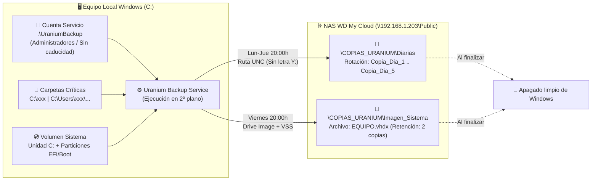

# 🛡️ Automated Windows & NAS Backup Architecture (Uranium Backup 9 Base)


-1F6FEB)


Arquitectura de respaldo corporativo automatizado para estaciones de trabajo Windows con **cuenta Microsoft / Autologin**, volcado mediante servicio en segundo plano hacia almacenamiento en red (**NAS WD My Cloud Home Duo en RAID 1**) utilizando rutas **UNC**, retención rotativa controlada y apagado automático al finalizar.

---

## 🏗️ Arquitectura del Sistema



---

## 📋 Política de Respaldo y Retención

| Conjunto | Frecuencia | Hora | Origen | Destino UNC en NAS | Retención | Post-Acción |
| :--- | :--- | :--- | :--- | :--- | :--- | :--- |
| **`Diarias`** | Lunes a Jueves | `20:00` | `C:\xxx`, `C:\Users\xxx\...` | `\\192.168.1.203\Public\COPIAS_URANIUM\Diarias` | **5 copias rotativas** (`Copia_Dia_1` a `5`) | Apagar PC |
| **`Imagen_Sistema`** | Viernes | `20:00` | Unidad `C:` + Volúmenes críticos | `\\192.168.1.203\Public\COPIAS_URANIUM\Imagen_Sistema` | **2 copias completas** (`.vhdx`) | Apagar PC |

---

## ⚙️ Despliegue Rápido (Runbook)

### 1. Creación de cuenta de servicio dedicada
Cuando Windows utiliza una cuenta Microsoft con PIN o inicio automático (*Autologin*), el servicio de copias no puede autenticarse con contraseña vacía ni credenciales en la nube. Se crea una cuenta local independiente:

* Ejecuta como Administrador el script incluido en [`scripts/setup-backup-service-user.ps1`](scripts/setup-backup-service-user.ps1) o lanza en CMD:
  ```cmd
  net user UraniumBackup <PASSWORD_SEGURA> /add
  net localgroup Administradores UraniumBackup /add
  wmic useraccount where name='UraniumBackup' set PasswordExpires=FALSE
  ```
* Abre `services.msc` > **Uranium Backup Service** > pestaña **Iniciar sesión** > selecciona **Esta cuenta** (`.\UraniumBackup`) para que Windows le conceda el derecho *Iniciar sesión como un servicio*, e inicia el servicio.

### 2. Regla crítica de acceso al NAS (Rutas UNC)
* **Nunca utilizar letras de unidad mapeadas (`Y:\`, `Z:\`)**, ya que pertenecen únicamente a la sesión visual del usuario y resultan invisibles para el servicio en segundo plano.
* Utilizar siempre la ruta UNC directa: `\\192.168.1.203\Public\COPIAS_URANIUM\...`

---

## 🚨 Recuperación de Disco Completo (Disaster Recovery / Bare-Metal)

### Escenario A: Windows arranca (Recuperación de archivos o restauración parcial)
1. **Extracción rápida desde el `.vhdx`:** Abre **Administración de discos** (`diskmgmt.msc`) > menú **Acción** > **Exponer VHD** > selecciona `\\192.168.1.203\Public\COPIAS_URANIUM\Imagen_Sistema\EQUIPO.vhdx` en modo **Solo lectura**. Se montará como una unidad adicional para copiar cualquier archivo o carpeta.
2. **Restauración guiada desde Uranium:** Abre Uranium Backup > menú **Restauración** > **Restaurar imagen de disco** y selecciona el archivo `.vhdx` en el NAS.

### Escenario B: El disco `C:` ha fallado o Windows no arranca (Bare-Metal Recovery)
1. **Arrancar desde medio de recuperación:**
   * Conecta un **USB de instalación de Windows 10/11** (creado previamente con la herramienta oficial de Microsoft) y arranca el equipo desde el USB.
   * En la primera pantalla de idioma, pulsa **`Shift + F10`** para abrir una consola de comandos con privilegios de sistema.
2. **Inicializar red y conectar con el NAS:**
   ```cmd
   wpeinit
   net use Z: \\192.168.1.203\Public
   dir Z:\COPIAS_URANIUM\Imagen_Sistema
   ```
   *(Si el NAS solicitara credenciales, añade `/user:usuario contraseña` al final del comando `net use`).*
3. **Preparar el disco físico nuevo (si se ha sustituido el SSD/HDD):**
   ```cmd
   diskpart
   list disk
   select disk 0
   clean
   convert gpt
   exit
   ```
4. **Volcar la imagen completa `.vhdx` sobre el disco:**
   * **Método 1 (Asistente gráfico de Windows):** Cierra la consola, pulsa **Siguiente** > **Reparar el equipo** > **Solucionar problemas** > **Recuperación de imagen del sistema**, selecciona la imagen ubicada en red (`\\192.168.1.203\Public\COPIAS_URANIUM\Imagen_Sistema`) y completa el asistente.
   * **Método 2 (Consola `wbadmin`):** Consulta el identificador de versión y lanza la recuperación:
     ```cmd
     wbadmin get versions -backupTarget:\\192.168.1.203\Public\COPIAS_URANIUM\Imagen_Sistema
     wbadmin start sysrecovery -version:<MM/DD/AAAA-HH:MM> -backupTarget:\\192.168.1.203\Public\COPIAS_URANIUM\Imagen_Sistema -restoreAllVolumes -recreateDisks -quiet
     ```
5. **Reiniciar y verificar:** Retira el USB, reinicia el equipo y confirma que Windows, los programas instalados y el servicio `Uranium Backup Service` arrancan con normalidad.

---

## 📁 Estructura del Repositorio

```text
backup-automation-uranium/
├── README.md                                        # Documentación principal y guía DR
├── docs/
│   └── Manual_Configuracion_Uranium_Backup.pdf      # Manual técnico completo en PDF
└── scripts/
    └── setup-backup-service-user.ps1                # Script automatizado de cuenta de servicio
```
